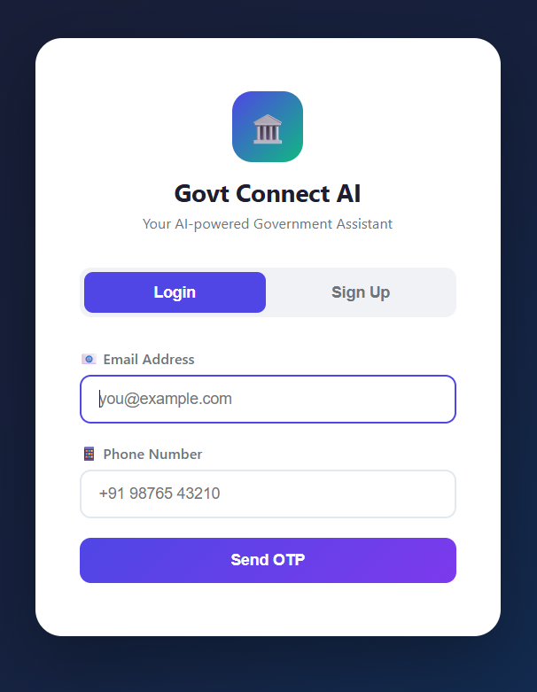
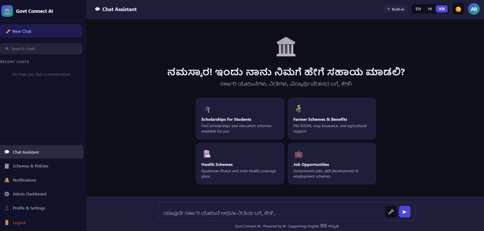
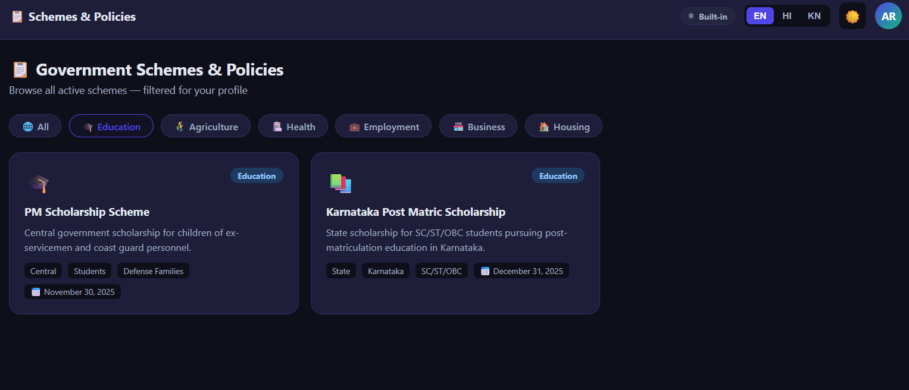

# 🏛️ Govt Connect AI

### AI-Powered Government Scheme Discovery & Assistance Platform

Govt Connect AI is a web-based platform designed to make government schemes and public services more accessible to citizens. It brings government scheme discovery, AI-oriented assistance, live government updates, and administrative management together in one unified platform.

---

## 📸 Project Preview

### 🔐 Login & Authentication



---

### 👤 Citizen Portal



---

### 🏛️ Government Schemes


---

## ✨ Key Features

### 👤 Citizen Portal
- Explore government schemes through a unified interface.
- Search schemes by name.
- Filter schemes based on categories.
- Access detailed scheme information.
- Explore Karnataka-specific government schemes.
- Access government-related assistance.

### 🤖 AI-Powered Assistance
- AI-oriented assistance interface.
- Designed to simplify access to government-related information.
- Helps users navigate government scheme information.

### 📡 Live Government Updates
- Integration with Press Information Bureau (PIB) RSS feeds.
- Fetch the latest government updates.
- Categorize updates based on their subject.
- Cache retrieved updates for efficient access.

### ⚙️ Admin Dashboard
- Dedicated administrative interface.
- Add new government schemes.
- Update existing scheme information.
- Manage and deactivate schemes.
- Bulk import government schemes.
- View platform statistics.
- Monitor registered users, chats, schemes, and live updates.

### 🔐 Authentication & Security
- User registration and login.
- Password hashing using bcrypt.
- JWT-based authentication.
- Protected API routes.
- Role-based administrator authorization.

---

## 🏗️ Technology Stack

| Category | Technologies |
|---|---|
| Frontend | HTML5, CSS3, JavaScript |
| Backend | Node.js, Express.js |
| Database | Supabase, PostgreSQL |
| Authentication | JSON Web Tokens (JWT), bcrypt |
| API Integration | REST APIs, Axios |
| Government Updates | PIB RSS Feed, Feedparser |
| File Handling | Multer |
| Scheduled Tasks | Node-cron |

---

## 📂 Project Structure

```text
Govt-Connect1-main/
│
├── assets/
│   ├── login.png
│   ├── user-portal.png
│   └── Schemes.png
│
├── backend/
│   ├── package.json
│   └── server.js
│
├── database/
│   └── supabase.js
│
├── frontend/
│   ├── index.html
│   └── login.html
│
├── middleware/
│   └── auth.js
│
├── routes/
│   ├── admin.js
│   ├── auth.js
│   ├── live.js
│   └── schemes.js
│
├── index.html
├── login.html
├── package.json
├── package-lock.json
├── server.js
├── LICENSE
└── Readme.md
```

---

## ⚙️ Installation & Setup

### 1. Clone the Repository

```bash
git clone <repository-url>
```

Navigate into the project directory:

```bash
cd Govt-Connect1-main
```

### 2. Install Dependencies

```bash
npm install
```

### 3. Configure Environment Variables

Create a `.env` file in the project root.

Configure the following environment variables:

```env
PORT=5000

SUPABASE_URL=your_supabase_url
SUPABASE_SERVICE_ROLE_KEY=your_supabase_service_role_key

JWT_SECRET=your_jwt_secret

PIB_RSS_URL=your_pib_rss_feed_url
```

Replace the placeholder values with your own configuration.

**Important:** Never expose your Supabase service role key or JWT secret. Do not upload your `.env` file to GitHub.

### 4. Database Configuration

The project uses Supabase with PostgreSQL.

Configure your Supabase project and create the required database tables for:

- Users
- Government schemes
- Chat sessions
- Live updates
- User activity logs

Refer to `database/supabase.js` for the database schema.

### 5. Run the Application

Start the backend using its configured server entry point:

```bash
npm start
```

The frontend and backend should be configured to communicate through the appropriate API endpoints.

---

## 🔗 API Modules

The backend is organized into separate route modules.

| Module | Responsibility |
|---|---|
| `auth.js` | User registration and login |
| `schemes.js` | Government scheme retrieval and filtering |
| `admin.js` | Administrative scheme management |
| `live.js` | PIB updates and Karnataka schemes |

---

## 🔒 Security Implementation

Security mechanisms implemented in the backend include:

- Password hashing with bcrypt.
- JWT token generation and verification.
- Authentication middleware.
- Administrator role verification.
- Protected administrative endpoints.
- Environment-based secret configuration.

---

## 🌱 Future Scope

Potential enhancements include:

- Multilingual assistance.
- Voice-based government assistance.
- Personalized scheme recommendations.
- Advanced eligibility checking.
- Additional government data integrations.
- Enhanced analytics and reporting.

---

## 🎯 Project Objective

The objective of Govt Connect AI is to simplify the way citizens discover and access government schemes and information through a centralized, accessible, and technology-driven platform.

---

**Built with ❤️ to make government information more accessible.**